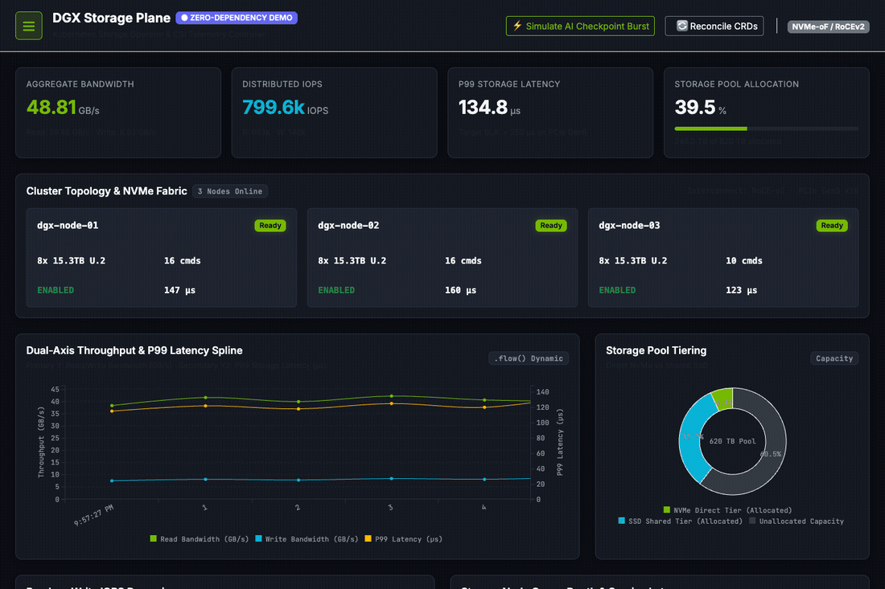

# k8s-distributed-storage-plane

> **Cloud-Native Distributed Storage Management Plane, Kubernetes Operator & CSI Plugin**

[](https://nodejs.org/)
[](https://kubernetes.io/)
[](https://kafka.apache.org/)
[](https://reactjs.org/)
[-orange.svg)](https://c3js.org/)
[](https://getbootstrap.com/)
[](#macos-m3-24gb-emulation--demo-recording)
[](#interactive-github-pages-demo)
[](LICENSE)

---

## Overview

**`k8s-distributed-storage-plane`** is a high-performance distributed storage management platform crafted for cloud-native infrastructure, high-throughput AI/ML workloads, and large-scale compute clusters. It provides an end-to-end control plane handling dynamic volume provisioning, direct storage telemetry streaming, Kubernetes Custom Resource reconciliation, and a real-time web management dashboard.

---

## Live Management Dashboard



*Figure: Real-time UI displaying dual-axis C3.js (`c3j`) throughput & P99 latency splines, distributed IOPS area chart, NVMe-oF node queue depths, dynamic volume claims, and live Kubernetes Storage Operator reconciliation stream.*

---

## Core Pillars & Architecture

1. **Kubernetes Storage Operator & Custom Controller (`k8s/operator/`)**
   * Custom Resource Definitions (CRDs): `DistributedStorageCluster` & `StorageVolumeClaim`.
   * Reconciler loop managing cluster health, quota enforcement, and automated node recovery.

2. **Container Storage Interface (CSI) Plugin Simulator (`k8s/csi/`)**
   * Identity Service: Plugin registration and capability reporting.
   * Controller Service: `CreateVolume`, `DeleteVolume`, and volume attachment orchestration.
   * Node Service: `NodeStageVolume`, `NodePublishVolume` (direct storage mount simulation), and `NodeGetVolumeStats`.

3. **Backend Management Plane (`server/`)**
   * Built using the `async` module (`async.waterfall`, `async.parallel`, `async.queue`) for parallel node health probes and batch volume operations.
   * Apache Kafka pipeline streaming sub-second telemetry (`storage-telemetry` & `cluster-events`).
   * MongoDB persistence for tenant quotas, volume catalogs, and audit logs.
   * WebSocket server for zero-latency metric broadcasts to client dashboards.

4. **Frontend Dashboard (`client/`)**
   * Real-time multi-axis time-series visualization using **C3.js (c3j)** and D3.
   * Dynamic DOM bindings and modal workflows powered by **jQuery**.
   * Responsive enterprise UI styled in **Bootstrap 5** with a modern dark theme.
   * Live streaming IOPS, Bandwidth (GB/s), and P99 Latency (microseconds) over WebSockets.

5. **Zero-Dependency Mock Engine & GitHub Pages Demo (`client/src/services/mockTelemetryService.js`)**
   * Built-in client-side mock service generating realistic live telemetry pulses, training checkpoint spikes, and simulated K8s events in-browser.
   * Enables 100% standalone interactive UI demo recording and single-click GitHub Pages deployment without requiring live cluster backends.

6. **macOS M3 (24GB) Multi-Node Local Cluster (`scripts/k8s_setup.sh`)**
   * 3-node local cluster setup (1 control plane + 2 worker nodes) for testing multi-node CSI volume attachments, node failover, and pod migrations.

---

## Storage Performance Calculations (Python Notation)

```python
# 1. Aggregate Bandwidth / Throughput (in GB/s)
throughput_GBps = (iops * block_size_KB) / (1024 * 1024)

# 2. Total I/O Service Time & Latency (microseconds)
total_latency_us = queue_time_us + service_time_us

# 3. P99 (99th Percentile) Latency from Sample Array
sorted_latencies = sorted(latency_samples)
p99_index = int(len(sorted_latencies) * 0.99)
latency_p99_us = sorted_latencies[p99_index]

# 4. Storage Pool Capacity Utilization Ratio
utilization_ratio = used_capacity_bytes / total_capacity_bytes
available_capacity_GB = (total_capacity_bytes - used_capacity_bytes) / (1024 ** 3)

# 5. Direct Storage Efficiency (accounting for interconnect & PCIe overhead)
effective_direct_bandwidth_GBps = raw_nvme_bandwidth_GBps * (1.0 - interconnect_overhead_factor)
```

---

## Directory Structure

```
k8s-distributed-storage-plane/
├── README.md                          # Project overview & documentation
├── LICENSE                            # Apache 2.0 open-source license
├── docs/                              # Project architecture & system manuals
│   ├── ARCHITECTURE.md                # Technical architecture & subsystem design
│   └── DOCUMENTATION.md               # Complete system documentation & runbook
├── HANDOFF.md                         # Engineering handoff & implementation spec
├── docker-compose.yml                 # Local multi-service stack (API, UI, Kafka, MongoDB)
├── quickstart.sh                      # Single-command bootstrap script
├── deploy.sh                          # K8s manifest deployment script
│
├── k8s/                               # Kubernetes Engine, CRDs, and CSI Driver
│   ├── kind-config.yaml               # 3-Node Kind cluster config for Colima (macOS M3)
│   ├── crds/
│   │   ├── storagecluster.crd.yaml    # DistributedStorageCluster CRD
│   │   └── storagevolume.crd.yaml     # StorageVolumeClaim CRD
│   ├── examples/
│   │   ├── storagecluster-sample.yaml # Sample production cluster manifest
│   │   └── storagevolume-sample.yaml  # Sample direct storage & cache claims
│   ├── operator/
│   │   ├── controller.js              # K8s Custom Controller / Live Kind reconciler
│   │   └── package.json
│   └── csi/
│       ├── driver.js                  # CSI Plugin (Identity, Controller, Node services)
│       └── storage_simulator.js       # NVMe-oF / Direct storage attachment mock
│
├── server/                            # Node.js + Express Backend
│   ├── package.json
│   └── src/
│       ├── server.js                  # Express server & WebSocket hub
│       ├── config/index.js            # Environment and cluster configuration
│       ├── orchestration/
│       │   └── asyncWorkflows.js      # async module orchestration (waterfall, parallel, queue)
│       ├── kafka/
│       │   └── kafkaService.js        # Telemetry producer & consumer
│       ├── db/
│       │   ├── mongoClient.js         # MongoDB connection & fallback in-memory store
│       │   └── models.js              # Schemas for Clusters, Volumes, Telemetry, Audits
│       └── routes/
│           ├── clusterRoutes.js       # Cluster management & node topology endpoints
│           ├── volumeRoutes.js        # Volume CRUD & CSI provision endpoints
│           └── telemetryRoutes.js     # Historical time-series query endpoints
│
├── client/                            # React + jQuery + C3.js + Bootstrap Frontend
│   ├── package.json                   # Includes "homepage": "./" for GitHub Pages
│   ├── public/
│   │   └── index.html                 # HTML5 shell loading Bootstrap 5 & C3 styles
│   └── src/
│       ├── index.js
│       ├── App.jsx                    # Main container
│       ├── styles/
│       │   └── storage-theme.css      # Dark theme styling & responsive layout
│       ├── components/
│       │   ├── Navbar.jsx             # Storage platform navigation & Mode badge
│       │   ├── ClusterOverview.jsx    # Node health cards & aggregate stats
│       │   ├── C3TelemetryChart.jsx   # 4 C3.js (c3j) time-series charts
│       │   ├── VolumeManager.jsx      # Volume allocation & storage attachment status
│       │   └── OperatorStatus.jsx     # K8s CRD reconciliation live event log
│       └── services/
│           ├── websocket.js           # Client-side WebSocket streaming consumer
│           └── mockTelemetryService.js # In-browser mock engine for GitHub Pages demo
│
└── scripts/                           # Python & Bash Automation
    ├── simulate_ai_workload.py        # Distributed PyTorch training I/O generator
    ├── benchmark_csi.py               # CSI volume mount & latency benchmark
    ├── k8s_setup.sh                   # Kind/Colima multi-node cluster bootstrap
    └── k8s_teardown.sh                # Kind cluster & Colima teardown script
```

---

### Git Commit Commands

To inspect and commit the repository, execute:

```bash
git add .
git commit -m "feat: complete k8s distributed storage management plane, operator, csi driver, and c3 dashboard"
```

---

### Execution Commands

#### 1. Instant Zero-Dependency UI Demo Mode (Client Simulator)

```bash
cd client
npm install
npm start
```

Access at `http://localhost:3000` with 4 live C3.js streaming charts, interactive AI checkpoint burst simulations, and volume provisioning.

**Interactive Video Screen Recording Flow:**
* **`⚡ Simulate AI Checkpoint Burst`**: In the navbar, triggers a synchronous 940k+ write IOPS spike and temporary latency increase, automatically recovering to baseline after 8 seconds.
* **`＋ Provision Volume`**: Above the table, dynamically allocates a new volume (e.g., 1500GB NVMe DirectStorage) and updates the Storage Pool Donut chart.
* **`⇄ Migrate`**: On any volume row, demonstrates live non-disruptive pod/volume migration between nodes.
* **`🔄 Reconcile CRDs`**: Triggers a manual health verification pass in the Kubernetes Operator log terminal.

#### 2. Backend API & Telemetry WebSocket Hub

```bash
cd server
npm install
npm start
```

#### 3. Kubernetes Multi-Node Cluster (Colima + Kind on macOS M3)

```bash
chmod +x scripts/*.sh *.sh

# Bootstrap Colima, create 3-node Kind cluster, register CRDs, and apply samples
./scripts/k8s_setup.sh

# Start the Storage Operator against the live Kind cluster
cd k8s/operator && npm start

# Inspect live CRDs and node attachments with kubectl
kubectl get nodes -o wide
kubectl get distributedstorageclusters -A
kubectl get storagevolumeclaims -A

# Tear down Kind cluster when finished (optional: add --all to stop Colima)
./scripts/k8s_teardown.sh
```

#### 4. Run AI Workload & CSI Latency Benchmarks

```bash
python3 scripts/simulate_ai_workload.py --nodes 3 --duration 30 --checkpoint-interval 10
python3 scripts/benchmark_csi.py --iterations 15
```

#### 5. Run Comprehensive Unit Tests (Backend, API, CSI, Async Workflows & Python Math)

```bash
chmod +x test.sh
./test.sh
```

Or test components individually:
```bash
# Server & Systems tests (Node.js built-in runner)
cd server && npm test

# Python storage formulas test (Python unittest)
python3 scripts/test_scripts.py

# Client component & mock tests
cd client && npm test -- --watchAll=false
```

---

## Project Documentation & Deep Dives

* 🏛️ **[Architecture Guide](docs/ARCHITECTURE.md)** — Comprehensive technical deep dive covering Kubernetes Operators, CSI gRPC architecture, Kafka telemetry streaming pipeline, storage performance formulas, and C3.js data visualization suite.
* 📖 **[System Documentation & Manual](docs/DOCUMENTATION.md)** — Complete operational and implementation guide covering declarative CRDs, async orchestration engine, benchmark tooling, and multi-node cluster verification.
