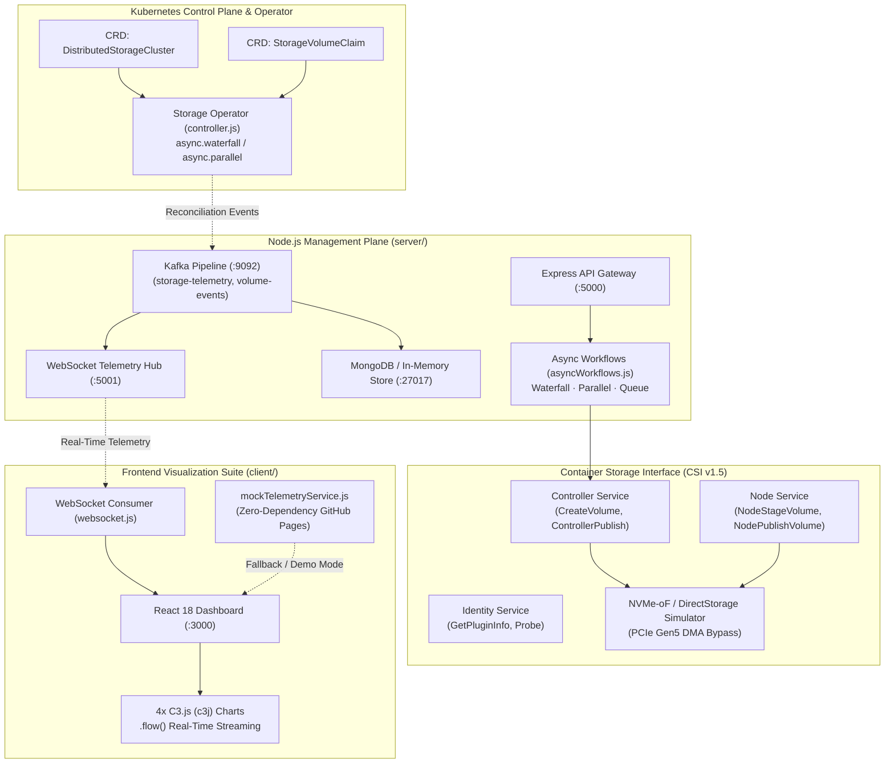
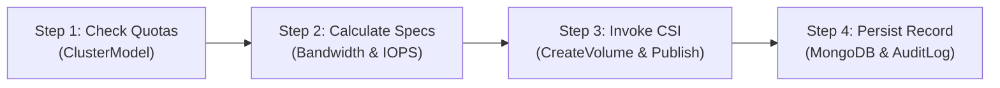
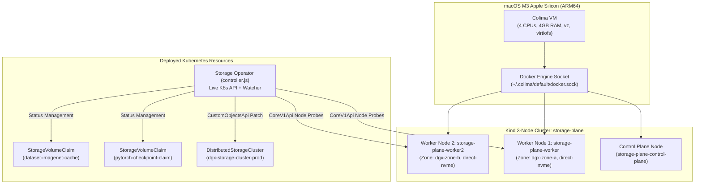

# k8s-distributed-storage-plane: Complete Technical Documentation & System Manual

**Target System:** Cloud-Native Distributed Storage Management Plane, Kubernetes Operator & CSI Plugin  
**Platform Target:** macOS Apple Silicon (M3 / arm64), Kubernetes (Colima + Kind), & Standalone GitHub Pages Demo  
**Location:** `k8s-distributed-storage-plane`

---

## Table of Contents

1. [Executive Summary & System Architecture](#1-executive-summary--system-architecture)
2. [Kubernetes Storage Operator & Declarative CRDs](#2-kubernetes-storage-operator--declarative-crds)
3. [Container Storage Interface (CSI) Plugin Implementation](#3-container-storage-interface-csi-plugin-implementation)
4. [Node.js Async Orchestration Engine](#4-nodejs-async-orchestration-engine)
5. [Kafka Streaming & Telemetry Ingestion Pipeline](#5-kafka-streaming--telemetry-ingestion-pipeline)
6. [Storage Performance Calculations (Python Notation)](#6-storage-performance-calculations-python-notation)
7. [Frontend Architecture & C3.js (c3j) Streaming Suite](#7-frontend-architecture--c3js-c3j-streaming-suite)
8. [Zero-Dependency In-Browser Mock Simulator & Screen Recording Guide](#8-zero-dependency-in-browser-mock-simulator--screen-recording-guide)
9. [Operational Runbook & Execution Guide](#9-operational-runbook--execution-guide)
10. [Colima & Multi-Node Kind Cluster Architecture](#10-colima--multi-node-kind-cluster-architecture)
11. [AI Workload & CSI Latency Benchmarking](#11-ai-workload--csi-latency-benchmarking)
12. [Comprehensive Unit Test Suite](#12-comprehensive-unit-test-suite)

---

## 1. Executive Summary & System Architecture

`k8s-distributed-storage-plane` is an enterprise control and data plane engineered for high-performance cloud storage in large-scale GPU/accelerator clusters. It integrates low-level Kubernetes storage primitives (Custom Resource Definitions, controllers, CSI volume attachments) with a high-throughput Node.js management plane, an Apache Kafka streaming pipeline, and a React + C3.js real-time analytics dashboard.



---

## 2. Kubernetes Storage Operator & Declarative CRDs

The operator encapsulates operational domain knowledge for managing high-performance distributed NVMe-oF pools.

### 2.1 DistributedStorageCluster CRD (`k8s/crds/storagecluster.crd.yaml`)
* **Group:** `storage.dgx.internal`
* **Version:** `v1alpha1`
* **Scope:** `Namespaced`
* **Key Spec Properties:**
  * `replicas` (integer): Number of storage worker nodes in the fabric.
  * `performanceTier` (string): `direct-nvme`, `standard-ssd`, `hybrid-tiered`.
  * `networkFabric` (string): `RoCE-v2`, `InfiniBand-NDR`, `TCP-PCIe`.
  * `storagePools` (array): Pool definitions with capacity (TB), IOPS targets, and bandwidth targets (GB/s).
* **Status Subresource:**
  * `state`: `Healthy`, `Degraded`, `Reconciling`.
  * `activeNodes`, `totalCapacityGB`, `allocatedCapacityGB`, `utilizationRatio`, `throughputGBps`, `p99LatencyUs`.

### 2.2 StorageVolumeClaim CRD (`k8s/crds/storagevolume.crd.yaml`)
* **Key Spec Properties:**
  * `sizeGB` (integer): Requested volume capacity.
  * `accessMode`: `ReadWriteOnce`, `ReadOnlyMany`, `ReadWriteMany`.
  * `storagePool`: Target tier (`nvme-direct-pool` or `ssd-shared-pool`).
  * `directStorageEnabled` (boolean): Flag enabling kernel-bypass zero-copy direct storage transfers.
  * `targetNode` (string): Worker node identifier.
* **Status Subresource:**
  * `phase`: `Pending`, `Bound`, `Attaching`, `Attached`, `Failed`.
  * `volumeHandle`: Unique CSI volume handle (`vol-dgx-XXXX`).
  * `effectiveBandwidthGBps`, `iopsLimit`, `latencyTargetUs`.

### 2.3 Reconciliation Engine (`k8s/operator/controller.js`)
Uses `@kubernetes/client-node` with automatic standalone fallback:
1. **Observe:** Queries active storage nodes and custom resources.
2. **Analyze:** Compares desired capacity and replica count with active hardware status.
3. **Act:** Employs `async.parallel` to probe node health concurrently and computes aggregate cluster metrics before patching K8s CR status.

---

## 3. Container Storage Interface (CSI) Plugin Implementation

Located in `k8s/csi/`, the plugin follows the CSI v1.5 specification across three distinct services:

### 3.1 Identity Service (`CSIDriver.GetPluginInfo`, `Probe`)
* Advertises plugin identifier: `dgx.storage.csi.k8s.io`.
* Exposes capabilities: `CONTROLLER_SERVICE`, `VOLUME_ACCESSIBILITY_CONSTRAINTS`, `ONLINE_EXPANSION`.
* Runs periodic health probes verifying RoCEv2 fabric connectivity.

### 3.2 Controller Service (`CSIDriver.CreateVolume`, `ControllerPublishVolume`)
* **`CreateVolume`:** Allocates block storage chunks from the requested pool, verifies capacity quotas, assigns NVMe Qualified Names (NQN) and PCIe addresses.
* **`DeleteVolume`:** Releases allocated space back to the storage pool.
* **`ControllerPublishVolume`:** Maps the allocated block device to the specified worker host.
* **`ControllerUnpublishVolume`:** Detaches device mapping prior to node re-balancing.

### 3.3 Node Service (`CSIDriver.NodeStageVolume`, `NodePublishVolume`, `NodeGetVolumeStats`)
* **`NodeStageVolume`:** Simulates ext4 formatting and staging to a global directory (`/var/lib/kubelet/plugins/kubernetes.io/csi/...`).
* **`NodePublishVolume`:** Bind-mounts the volume into container filesystem paths and initializes DirectStorage DMA buffers.
* **`NodeGetVolumeStats`:** Gathers real-time telemetry: available/used bytes, live IOPS, throughput (GB/s), and P99 latency (µs).

---

## 4. Node.js Async Orchestration Engine

Located in `server/src/orchestration/asyncWorkflows.js`, the platform avoids deeply nested callback hell and race conditions by applying specific `async` module primitives:

### 4.1 Sequential Volume Provisioning via `async.waterfall`

* **Step 1:** Verifies cluster allocation ceiling (`allocatedCapacityGB + sizeGB <= totalCapacityGB`).
* **Step 2:** Calculates effective throughput considering interconnect overhead.
* **Step 3:** Dispatches synchronous creation and attachment calls to `csiDriver`.
* **Step 4:** Persists record to the volume collection and logs an audit entry.

### 4.2 Concurrent Health Probes via `async.parallel`
* Queries `dgx-node-01`, `dgx-node-02`, and `dgx-node-03` simultaneously.
* Collects PCIe queue depths and latency samples without blocking the main event loop.

### 4.3 Worker Queue via `async.queue`
* Manages live volume migrations with concurrency capped at 2.
* Prevents RoCEv2 fabric congestion during multi-node failovers.

---

## 5. Kafka Streaming & Telemetry Ingestion Pipeline

Located in `server/src/kafka/kafkaService.js`:

* **Topics:**
  1. `storage-telemetry`: High-frequency metrics (IOPS, GB/s, latency distributions, queue depth).
  2. `volume-events`: CSI lifecycle events (provisioned, attached, detached, deleted).
  3. `cluster-alerts`: Hardware health, SMART keepalives, and AI checkpoint surge notifications.
* **Ingestion to WebSocket Flow:**
  1. High-cadence producer emits metric snapshots at 1-second intervals.
  2. Consumer stores historical points in MongoDB (`telemetry` collection).
  3. Server broadcasts JSON frames to connected WebSockets (`ws://0.0.0.0:5001`).

---

## 6. Storage Performance Calculations (Python Notation)

The core metrics engine across scripts, operator, and backend simulator relies on the following standard formulas:

```python
# 1. Aggregate Bandwidth / Throughput (in GB/s)
# Converts IOPS and block size in KB to gigabytes per second
throughput_GBps = (iops * block_size_KB) / (1024 * 1024)

# 2. Total I/O Service Time & Latency (microseconds)
total_latency_us = queue_time_us + service_time_us

# 3. P99 (99th Percentile) Latency Calculation
sorted_latencies = sorted(latency_samples)
p99_index = int(len(sorted_latencies) * 0.99)
latency_p99_us = sorted_latencies[min(p99_index, len(sorted_latencies) - 1)]

# 4. Storage Pool Capacity Utilization Ratio
utilization_ratio = used_capacity_bytes / total_capacity_bytes
available_capacity_GB = (total_capacity_bytes - used_capacity_bytes) / (1024 ** 3)

# 5. Direct Storage Effective Bandwidth (with interconnect overhead)
# interconnect_overhead_factor is typically 0.05 for RoCEv2 / PCIe Gen5
effective_direct_bandwidth_GBps = raw_nvme_bandwidth_GBps * (1.0 - interconnect_overhead_factor)
```

---

## 7. Frontend Architecture & C3.js (c3j) Streaming Suite

The client dashboard (`client/src/`) provides real-time visualization without UI thread lockup.

### 7.1 The 4 C3.js (`c3j`) Charts (`C3TelemetryChart.jsx`)
1. **Dual-Axis Throughput & P99 Latency (Spline):**
   * Primary Y-Axis: Read Bandwidth (`#76b900`) and Write Bandwidth (`#00b4d8`) in GB/s.
   * Secondary Y2-Axis: P99 Latency (`#ffb703`) in microseconds.
   * Streaming: Updates smoothly via C3's native `.flow()` API at 1-second intervals.
2. **Read vs. Write IOPS Dynamics (Area-Spline):**
   * Visualizes dataset ingestion reads versus checkpoint burst writes.
3. **Storage Pool Tiering & Allocation (Donut):**
   * Displays NVMe Direct Tier vs SSD Shared Tier vs Unallocated Pool Capacity.
4. **Storage Node Queue Depth & Service Latency (Grouped Bar):**
   * Highlights individual host controller load across `dgx-node-01`, `dgx-node-02`, and `dgx-node-03`.

### 7.2 Interactive Modals & Theme
* Dark theme designed for high-performance enterprise aesthetics (`#0b0e14` background, `#76b900` accents).
* jQuery modal bindings for dynamic volume provisioning and live node migration triggers.

---

## 8. Zero-Dependency In-Browser Mock Simulator & Screen Recording Guide

`client/src/services/mockTelemetryService.js` empowers standalone demos and high-fidelity video screen recordings without requiring Docker, Kafka, MongoDB, or Kubernetes backends.

### 8.1 How to Start the Demo Mode

```bash
cd client
npm install
npm start
```

Access the dashboard at `http://localhost:3000`. The navbar displays **`● ZERO-DEPENDENCY DEMO`**, confirming that the client simulator is driving the entire dashboard.

### 8.2 Interactive Script for Video Screen Recording

During your screen recording, follow this 4-step interactive flow to showcase real-time telemetry and Kubernetes storage orchestration:

1. **Trigger AI Checkpoint Surge:**
   * Click **`⚡ Simulate AI Checkpoint Burst`** in the top navbar.
   * **Visual Effect:** Write IOPS instantly spikes from ~120k to **940k+ IOPS**. Bandwidth surges on the Dual-Axis Spline and Area-Spline charts. P99 latency rises to ~380µs, and node queue depths jump to ~40 commands. After 8 seconds, the workload automatically recovers to baseline with a completion log entry.

2. **Dynamically Provision a Storage Volume:**
   * Click **`＋ Provision Volume`** above the volume inventory table.
   * Enter or retain defaults (e.g. `transformer-weights-v2`, `1500 GB`, `nvme-direct-pool`, DirectStorage enabled).
   * Click **`Execute CSI Provisioning`**.
   * **Visual Effect:** The modal closes, a new row appears in the table with `BYPASS ON`, the Storage Pool Donut chart updates its allocated slice, and a CSI bind event is posted to the operator log stream.

3. **Demonstrate Volume Migration & Node Failover:**
   * Click **`⇄ Migrate`** on any volume in the table.
   * **Visual Effect:** The volume switches attached nodes (e.g. from `dgx-node-01` to `dgx-node-02`) representing non-disruptive live volume failover.

4. **Trigger Operator Reconciliation:**
   * Click **`🔄 Reconcile CRDs`** to show the simulated Kubernetes Custom Controller executing a health check pass across the 3 nodes.

---

## 9. Operational Runbook & Execution Guide

### Execution Commands

#### 1. Instant Zero-Dependency UI Demo Mode (Client Simulator)

```bash
cd client
npm install
npm start
```

Access at http://localhost:3000 with 4 live C3.js streaming charts, interactive AI checkpoint burst simulations, and volume provisioning.

#### 2. Backend API & Telemetry WebSocket Hub

```bash
cd server
npm install
npm start
```

#### 3. Kubernetes Multi-Node Cluster (Colima + Kind on macOS M3)

```bash
chmod +x scripts/*.sh *.sh

# 1. Bootstrap Colima runtime, create 3-node Kind cluster, apply CRDs and samples
./scripts/k8s_setup.sh

# 2. Run the Custom Storage Operator against the live Kind cluster
cd k8s/operator && npm start

# 3. Verify live nodes, CRDs, and status patches with kubectl
kubectl get nodes -o wide --show-labels
kubectl get distributedstorageclusters -A -o wide
kubectl get storagevolumeclaims -A -o wide

# 4. Tear down Kind cluster when finished (add --all to also stop Colima)
./scripts/k8s_teardown.sh
```

#### 4. Run AI Workload & CSI Latency Benchmarks

```bash
python3 scripts/simulate_ai_workload.py --nodes 3 --duration 30 --checkpoint-interval 10
python3 scripts/benchmark_csi.py --iterations 15
```

#### 5. Running with Full Docker Compose
```bash
docker-compose up --build
```

---

## 10. Colima & Multi-Node Kind Cluster Architecture

To validate Kubernetes storage orchestration on macOS Apple Silicon (M3 / arm64), the platform integrates **Colima** (minimal container runtime on macOS) and **Kind** (Kubernetes in Docker). This allows realistic multi-node volume attachment, node failover, and pod migration testing locally without cloud infrastructure overhead.



### 10.1 Cluster Specification (`k8s/kind-config.yaml`)
* **Control Plane:** Handles Kubernetes API, controller manager, and scheduler.
* **Worker Nodes:**
  * `storage-plane-worker`: Labeled with `storage-tier: direct-nvme`, `topology.kubernetes.io/zone: dgx-zone-a`, and `storage.dgx.internal/node-id: dgx-node-01`.
  * `storage-plane-worker2`: Labeled with `storage-tier: direct-nvme`, `topology.kubernetes.io/zone: dgx-zone-b`, and `storage.dgx.internal/node-id: dgx-node-02`.

### 10.2 Sample Declarative Resources (`k8s/examples/`)
* **[`storagecluster-sample.yaml`](k8s/examples/storagecluster-sample.yaml):** Declares production NVMe (120TB) and SSD (500TB) pools on RoCEv2 fabric.
* **[`storagevolume-sample.yaml`](k8s/examples/storagevolume-sample.yaml):** Declares a 2000GB direct GPU bypass claim and an 8000GB read-only shared cache claim.

### 10.3 Live Operator Reconciliation
When `k8s/operator/controller.js` runs with a live Kind kubeconfig:
1. Automatically detects Kubernetes cluster connectivity.
2. Queries live nodes using `k8s.CoreV1Api.listNode()` (`storage-plane-control-plane`, `storage-plane-worker`, `storage-plane-worker2`).
3. Queries custom objects via `k8s.CustomObjectsApi` for `distributedstorageclusters`.
4. Reconciles cluster health and patches the live status subresource in Kubernetes with real-time throughput, P99 latency, and node health.

### 10.4 Cluster Provisioning & Teardown Commands
```bash
# Provision Colima and 3-Node Kind cluster, apply CRDs and samples
./scripts/k8s_setup.sh

# Run Operator against live cluster
cd k8s/operator && npm start

# Tear down Kind cluster when finished
./scripts/k8s_teardown.sh          # Deletes Kind cluster
./scripts/k8s_teardown.sh --all    # Deletes Kind cluster and stops Colima
```

---

## 11. AI Workload & CSI Latency Benchmarking

Run the included Python CLI benchmarking tools to simulate distributed training traffic and measure CSI driver operation latency:

```bash
# 1. Distributed PyTorch Training Workload Generator (Ingestion reads + Checkpoint burst writes)
python3 scripts/simulate_ai_workload.py --nodes 3 --duration 30 --checkpoint-interval 10

# 2. CSI Driver CreateVolume, ControllerPublish, and NodeStage P99 Latency Benchmark
python3 scripts/benchmark_csi.py --iterations 20
```

---

## 12. Comprehensive Unit Test Suite

Checking the current state of the code repository is prudent to confirm all generated files are tracked. A comprehensive unit test suite has been created covering all API endpoints, business logic, asynchronous orchestration workflows, CSI plugin services, and mathematical performance formulas—without adding any external dependencies (utilizing Node.js 18+ built-in `node:test` / `node:assert` and Python's built-in `unittest`).

---

### Test Suite Structure

| Component / Subsystem | Test File | Scope & Assertions |
| :--- | :--- | :--- |
| **REST API Gateway** | [`server/test/api_routes.test.js`](server/test/api_routes.test.js) | Validates `/health`, `/api/cluster/overview`, `/api/cluster/nodes`, `/api/cluster/reconcile`, volume CRUD (`/api/volumes`), node migrations (`/api/volumes/:id/migrate`), and burst simulations. |
| **Async Orchestration Engine** | [`server/test/async_workflows.test.js`](server/test/async_workflows.test.js) | Tests `async.waterfall` (quota check, bandwidth calculation, CSI allocation, DB save), quota overflow rejection, `async.parallel` (concurrent node probes), and `async.queue` (worker migration queue). |
| **CSI Driver & Hardware Simulator** | [`server/test/csi.test.js`](server/test/csi.test.js) | Tests Identity (`GetPluginInfo`, `Probe`), Controller (`CreateVolume`, `ControllerPublish`, `DeleteVolume`), Node (`NodeStageVolume`, `NodePublishVolume`, `NodeGetVolumeStats`), and storage formulas. |
| **Kubernetes Storage Operator** | [`server/test/operator.test.js`](server/test/operator.test.js) | Validates `calculateClusterMetrics` (throughput, direct bandwidth, P99 latency) and multi-step `reconcileCluster` loop. |
| **Database & Models Layer** | [`server/test/db_models.test.js`](server/test/db_models.test.js) | Validates `InMemoryCollection` CRUD engine and `ClusterModel`, `VolumeModel`, `TelemetryModel`, `AuditModel`. |
| **Kafka Pipeline & Telemetry** | [`server/test/kafka_telemetry.test.js`](server/test/kafka_telemetry.test.js) | Tests baseline telemetry pulses, AI checkpoint burst write surges, elevated latencies, and alert broadcasts. |
| **Python Formulas & Benchmarks** | [`scripts/test_scripts.py`](scripts/test_scripts.py) | Tests Python math formulas (`calculate_throughput_GBps`, `calculate_direct_storage_bandwidth`, `calculate_p99_latency_us`). |
| **Frontend Simulator Engine** | [`client/src/__tests__/`](client/src/__tests__/) | Tests `mockTelemetryService` volume CRUD, migration, AI burst triggers, and `websocket.js` mode fallback. |

---

### Execution Commands

#### Run All Tests via Root Test Runner

```bash
chmod +x test.sh
./test.sh
```

#### Run Individual Test Suites

```bash
# 1. Backend, API, CSI, Operator, & Async tests (Node.js built-in runner)
cd server && npm test

# 2. Python storage formulas & benchmark tests (Python unittest)
python3 scripts/test_scripts.py

# 3. Client components & mock engine tests
cd client && npm test -- --watchAll=false
```
